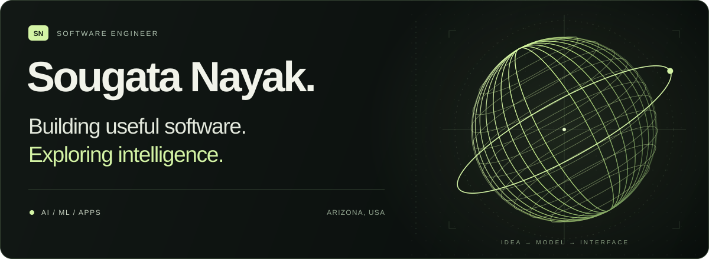

<!-- Profile README for github.com/sougata-nayak. Keep assets/ beside this file. -->

  

  <a href="#selected-work">Selected work</a> &nbsp; / &nbsp;
  <a href="#toolbox">Toolbox</a> &nbsp; / &nbsp;
  <a href="https://www.linkedin.com/in/sougata-nayak/">LinkedIn</a> &nbsp; / &nbsp;
  <a href="mailto:sougatanayak007@gmail.com">Email</a>

 

## A little context

I'm **Sougata**, a software engineer based in **Arizona, USA**. These days, I'm working on **AI projects**, building on a background in mobile development, machine learning, and data visualization.

I like turning complex problems into software that feels clear and useful — whether that's a predictive model, a live dashboard, or an app people use every day.

**Current direction:** AI applications, practical ML, and thoughtful interfaces. I'll be sharing more of that work here as new repositories go public.

 

## Selected work

### 01 &nbsp; / &nbsp; Arizona Traffic Accident Severity Prediction

**Machine learning · Public safety · Data analysis**

Predicting injury severity from Arizona fatal-crash records spanning 2012–2016. A full ML workflow covering data cleaning, feature engineering, exploratory analysis, and model comparison.

The project README reports **82.26% test accuracy with XGBoost**, alongside comparisons with Random Forest, SVM, and other classifiers.

`Python` `pandas` `scikit-learn` `XGBoost` `Jupyter`

[Explore the project ↗](https://github.com/sougata-nayak/traffic-accidents-arizona-python)

---

### 02 &nbsp; / &nbsp; Live System Monitor

**Desktop software · Real-time data · Interface design**

A live desktop dashboard for CPU, memory, network, and disk activity, with animated charts, per-core inspection, and a top-process view. Developed on macOS, with separate sampling and rendering loops for smooth updates.

`Python` `PySide6` `psutil` `pyqtgraph`

[Explore the project ↗](https://github.com/sougata-nayak/live-system-monitor)

---

### 03 &nbsp; / &nbsp; BEFI – IBEU

**Mobile development · Information access**

A mobile app that gives Indian Bank employees quick access to events, updates, employee-rights information, and bipartite settlements.

`Flutter` `Dart`

[Explore the project ↗](https://github.com/sougata-nayak/ibeu-asansol)

 

**Also exploring:** [BitExTract](https://github.com/sougata-nayak/BitExTract), a project concept for interactive visualization of Bitcoin exchange intelligence. The public repository currently contains an overview.

[Browse all repositories ↗](https://github.com/sougata-nayak?tab=repositories)

<!--
FUTURE PROJECT SLOT — copy this block above the first selected project when ready.
Keep only 3–4 featured projects; move older ones into the "Also exploring" line.
Do not present a planned project as a shipped one.

### 01 &nbsp; / &nbsp; PROJECT NAME

**FOCUS AREA · PROBLEM DOMAIN**

What the project does, who it helps, and one concrete technical detail.
Add an evaluation result or demo only when available and documented.

`Primary language` `Framework` `AI/ML tool`

[Explore the project ↗](REPOSITORY_URL)

Renumber the remaining projects after adding a new one.
-->

 

## Toolbox

| Area | Technologies |
| :--- | :--- |
| **ML & data** | Python · pandas · NumPy · scikit-learn · XGBoost · Jupyter |
| **Apps & interfaces** | Flutter · Dart · React · TypeScript · JavaScript · PySide6 |
| **Backend & cloud** | Node.js · AWS · Firebase · Docker · Kubernetes |
| **Also in my toolkit** | Java · Kotlin · C++ · Git |

<!-- Add AI frameworks here as they become part of your published project work. -->

 

## Background

**MS in Computer Science, Arizona State University** · GPA **3.81 / 4.0**

My experience spans Flutter apps at **Skywa Solutions**, an AI-based invoice management app at **HighRadius**, and mobile projects for **The Federation of Entrepreneurship, KIIT** and **Innofinity Manufacturers**.

More about my engineering experience

- **Skywa Solutions** — Developed a mobile queueing and scheduling app with 5,000+ downloads and 78% retention.
- **HighRadius Corporation** — Built an invoice management app integrating ML models with a React interface.
- **The Federation of Entrepreneurship, KIIT** — Created a Kotlin and Firebase event app used by 50+ teams nationwide.
- **Innofinity Manufacturers Pvt. Ltd.** — Built an app that interacted with IoT devices for fleet management.

Earlier milestones include the **Google Cloud Facilitator Program**, **Hacktoberfest 2020**, and the **GeeksforGeeks 11-week DSA workshop**.

 

---

  <b>Have a useful problem in mind? Let's build something.</b>  
  <a href="https://www.linkedin.com/in/sougata-nayak/">LinkedIn</a> &nbsp; · &nbsp;
  <a href="mailto:sougatanayak007@gmail.com">sougatanayak007@gmail.com</a> &nbsp; · &nbsp;
  <a href="https://github.com/sougata-nayak">GitHub</a>

